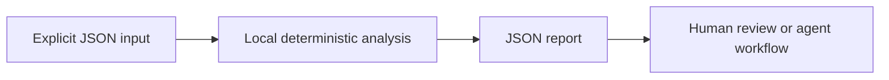

<div align="center">


[](https://github.com/XingCEO/zarr-chunk-budget/actions/workflows/ci.yml)

[](LICENSE)


**Estimate chunk read amplification against your actual slice workload.**

[Try it](#quickstart) · [Input contract](#input-contract) · [Example report](examples/output.json) · [Contribute](CONTRIBUTING.md)

</div>

## The problem

A chunk shape that looks reasonable can turn a small microscopy or climate-data slice into hundreds of object-store reads. Array size alone does not describe the access pattern.

## How it works

For each candidate chunk shape, count the exact chunk intersections for rectangular half-open queries, including edge chunks. Weight requests and uncompressed bytes by observed query frequency and score them using a configurable request penalty. Reports separate logical payload from fetched chunk bytes.



## Quickstart

Requires Python 3.11 or later. The analyzer has **no runtime dependencies**, makes no network requests and runs no shell commands. Domain-specific interpretation (such as SQL rehearsal) is described below.

```bash
git clone https://github.com/XingCEO/zarr-chunk-budget.git
cd zarr-chunk-budget
python3 -m zarr_chunk_budget examples/input.json
```

Optional installation into an isolated environment:

```bash
python3 -m venv .venv
. .venv/bin/activate
python -m pip install .
zarr-chunk-budget examples/input.json
```

The package is installed from this checkout; no PyPI publication is claimed.

## Input contract

Use [the complete example](examples/input.json) as a starting point. Paths and strings in JSON are data unless the contract explicitly says they refer to local files.

| Field | Meaning |
| --- | --- |
| `shape / item_bytes` | Dense array dimensions and uncompressed bytes per element. |
| `candidates` | Chunk shapes to compare; same dimensionality as shape. |
| `queries` | start/stop arrays using half-open bounds, optional frequency weight. |
| `request_penalty_bytes` | Convert one request into an equivalent byte cost; default 0. |

## Example result

Generated by running the committed example:

```json
{
  "best": [
    1,
    100,
    100
  ],
  "candidates": [
    {
      "chunks": [
        1,
        100,
        100
      ],
      "read_amplification": 1.9801980198019802,
      "score": 881920.0,
      "total_array_chunks": 100,
      "weighted_fetched_bytes": 800000.0,
      "weighted_logical_bytes": 404000.0,
      "weighted_requests": 20.0
    },
    {
      "chunks": [
        10,
        10,
        10
      ],
      "read_amplification": 9.910891089108912,
      "score": 8104096.0,
      "total_array_chunks": 1000,
      "weighted_fetched_bytes": 4004000.0,
      "weighted_logical_bytes": 404000.0,
      "weighted_requests": 1001.0
    }
  ],
  "model": "uncompressed, no cache, unit-stride rectangular reads"
}
```

## Use from another tool

```python
import json
from zarr_chunk_budget import analyze

with open("examples/input.json", encoding="utf-8") as stream:
    report = analyze(json.load(stream))
```

`analyze(data)` returns a JSON-serializable dictionary. The CLI accepts `-` for stdin, writes reports to stdout and input errors to stderr. Exit `0` means analysis completed, including reports containing findings; exit `2` means invalid input or an unreadable file. Gate CI on the report's documented fields, rather than assuming exit `0` means no findings. The JSON report is a v0.1 interface and may evolve before 1.0.

## Validation

```bash
python3 -m unittest discover -v
```

Tests cover the example, malformed CLI input, and the domain-specific boundary cases in [tests/test_core.py](tests/test_core.py). CI also installs the package and runs its console entry point on Python 3.11 and 3.13. Test success demonstrates these cases; it is not evidence of production deployment.

## Scope and limits

Dense rectangular unit-stride slices only. No codecs, compression ratios, sharding, caching, object-store latency distribution or Zarr writes are modeled. Candidate selection is only as representative as the supplied workload.

This is a focused experimental first release. Review findings before changing production systems. Inputs and reports may contain your own source or metadata; keep them in an appropriate local workspace.

## Related work and references

- [Zarr performance guidance](https://zarr.readthedocs.io/en/stable/user-guide/performance/)
- [Rechunker](https://github.com/pangeo-data/rechunker)

These projects and specifications inform the problem space. This repository is an independent implementation; it does not claim to replace the referenced systems or to have invented the underlying techniques.

## Contributing

A small real-world fixture with expected behavior is the most useful contribution. See [CONTRIBUTING.md](CONTRIBUTING.md). Please remove private data before filing an issue.

## License

[MIT](LICENSE) © 2026 XingCEO.
